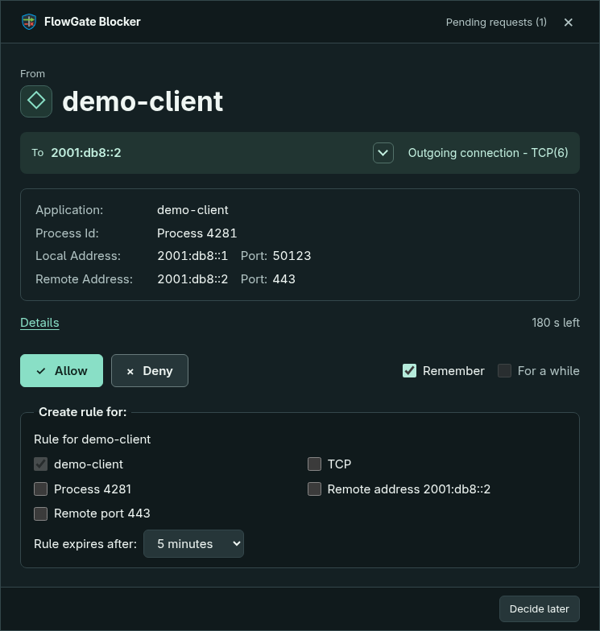

# FlowGate

**See which apps are online and decide what they can connect to.**

FlowGate is a Linux application firewall and network monitor. See live traffic
by app, allow or block connections, and look up past firewall decisions from
the desktop. The per-app monitoring and control workflow takes inspiration from
[NetLimiter](https://netlimiter.com/).

[Try the desktop](#try-the-desktop) · [Install FlowGate](#install-flowgate) ·
[Documentation](#documentation)


*The Activity view shows simulated traffic. On wide windows,
the inspector sits beside the traffic chart and app table.*

## What you can do

- **See network activity.** Browse active sockets by app and process, watch
  live upload and download charts, and opt in to keeping 1, 7, or 30 days of
  data. [Usage history](docs/USAGE-HISTORY.md)
- **Decide what gets through.** Allow or block supported TCP and UDP traffic by
  verified application, user, and direction. Make a temporary choice at a prompt or
  save a rule for future connections. [How rules work](docs/SEMANTICS.md)
- **Find out what the firewall decided.** Look up recorded firewall decisions
  and their reasons. Usage and decision records reflect what FlowGate observed.
  Both can have gaps. [Decision Log](docs/DECISION-LOG.md)
- **Set separate rules for Windows apps.** With supported Wine and Proton
  runtimes, FlowGate distinguishes Windows executables and Wine prefixes.
  [Tested runtimes and scope](docs/PROTON-LAUNCHER-REGRESSION.md)
- **Limit bandwidth (experimental).** Apply limits and priorities to eligible
  native app traffic. Download limits cover established TCP on supported routes.
  [Limits and priorities](docs/ZONE-SHAPING.txt) ·
  [Download coverage](docs/DOWNLOAD-LIMITER.txt)



*An outgoing Ask prompt with a five-minute rule duration. The For a while
buttons use the one-minute duration below Next request.*

## Try the desktop

As your desktop user, clone the repository and run the preview. The first run
downloads the locked Electron dependencies and Go modules, builds the app, and
opens live Activity with a private read-only observer. Press Ctrl+C in the
launch terminal to stop the preview. [Desktop prerequisites](electron/README.md)

```sh
git clone https://github.com/OzoneH3/flowgate.git
cd flowgate
./scripts/run-electron.sh
```

## Install FlowGate

The standalone candidate targets **64-bit x86 Linux with systemd**. From a
clean checkout of the revision you want to install, run the following as the
intended desktop administrator. First check the
[build and host requirements](docs/STANDALONE-RELEASE.md#requirements).

```sh
make update
```

This command builds the checked-out commit, verifies the archive, runs preflight
and installs with sudo. In a graphical session it opens the matching installed
desktop. To upgrade from public `master` later, run `git pull --ff-only`,
review the new revision, then run `make update` again. To open the installed app at any time, use
the application menu or run `flowgate-ui`.

Run `make help` for individual build, package, install and recovery commands.
The [standalone guide](docs/STANDALONE-RELEASE.md) covers staged installation,
checksum verification for a candidate downloaded from [GitHub Releases](https://github.com/OzoneH3/flowgate/releases),
and rollback. The [verification record](docs/STANDALONE-RELEASE.md#verification-record)
identifies the audited builds and the guest checks still pending.

A fresh install starts in **Monitoring**. When you're ready to enable
protection, review essential networking first. Then choose **Incoming only**
or **Incoming + outgoing**, select **Check readiness**, and use **Start protection**.
The system service runs as root and continues running when the desktop closes.
Use **Stop protection** to return to monitoring. [Essential networking](docs/ESSENTIAL-NETWORKING.md)

## Good to know

- **An app needs verified ownership.** When a socket is shared, its owner has
  exited, or FlowGate can't inspect it, the app's saved permission cannot be
  applied on the strength of a guess. [How ownership is verified](docs/ATTRIBUTION.md)
- **A newly created or enabled Block can disconnect open TCP connections.**
  FlowGate does this during active protection when the Block becomes the winning
  decision and FlowGate can verify the exact socket, its owner, and the connection
  direction. Starting protection preserves open connections. A later winning
  Block can still disconnect them. [Connection and rule semantics](docs/SEMANTICS.md)
- **Local can include VPN peers.** For example, a remote desktop connection to
  `192.168.23.155` over `ppp0` is automatically classified as Local. Choose
  **Local** to scope a rule to that zone. Configured prefixes can override
  automatic classification. [Automatic zones](docs/AUTOMATIC-ZONES.md)
- **VPN support depends on the setup.** TUN traffic is subject to ordinary
  application rules. WireGuard and XFRM interfaces currently prevent activation.
  Use the read-only checks to investigate firewall, routing, or VPN conflicts.
  [Network compatibility](docs/COEXISTENCE.md) · [Diagnostics](docs/DIAGNOSTICS.md)

## Diagnose before explicit activation

On a standalone installation, run `/usr/local/lib/flowgate/current/flowgate doctor`.
From a source checkout, use the commands below. Doctor reports what it could
check without changing firewall settings or requesting sudo.

```sh
. scripts/go-env.sh
go build -o build/flowgate ./cmd/flowgate
build/flowgate doctor
```

Use `doctor --json` for structured output. FlowGate also runs live compatibility
checks when you enable protection. [Read the diagnostic and recovery guide](docs/DIAGNOSTICS.md)

## Documentation

| I want to… | Read |
| --- | --- |
| Use Activity, prompts, the tray, and saved rules | [Electron desktop guide](electron/README.md) |
| Know who can see traffic or edit rules | [Authorization](docs/AUTHORIZATION.md) |
| Check supported Wine/Proton versions and attribution | [Wine and Proton guide](docs/WINE.md) |
| Package a standalone release, recover or uninstall | [Standalone release guide](docs/STANDALONE-RELEASE.md) |
| Maintain a pinned checkout deployment or attach a development desktop | [Developer deployment guide](docs/DAILY-DEPLOYMENT.md) · [Script reference](scripts/README.md) |
| Work on the Unix API, Qt client, or core | [API](docs/API.md) · [Qt client](desktop/README.md) · [Integration map](docs/INTEGRATION.md) |
| Review project status and test evidence | [Status](docs/STATUS.md) · [Historical records](docs/HANDOFF.md) |
