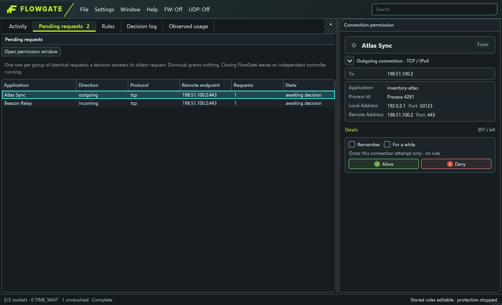
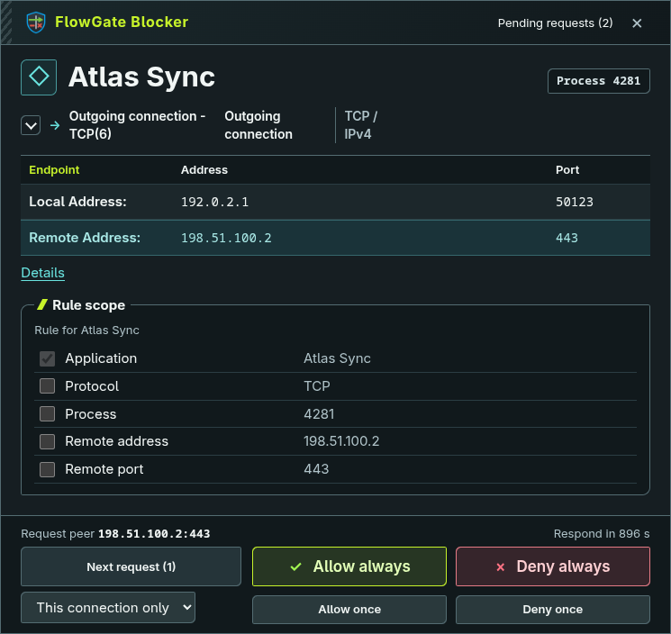

# FlowGate

**See which apps are online and decide what they can connect to.**

FlowGate is a Linux application firewall and network monitor inspired by
[NetLimiter](https://netlimiter.com/).

[Features](#features) · [Tested systems](#supported-systems-and-limitations) ·
[Try the desktop](#try-the-desktop) · [Build, install or update](#install-flowgate)

## Features

- See live traffic per app and opt in to 1, 7 or 30 days of [usage history](docs/USAGE-HISTORY.md).
- **Allow, Block or Ask** for inbound and outbound TCP/UDP. Answer once or [save a rule](docs/SEMANTICS.md).
- Review decisions and their reasons in the [Decision Log](docs/DECISION-LOG.md).
- Set per-executable rules within each prefix on [supported Wine/Proton setups](docs/PROTON-LAUNCHER-REGRESSION.md).
- **Experimental** [bandwidth limits and traffic priorities](docs/ZONE-SHAPING.txt) for eligible native apps.

## Supported systems and limitations

The standalone package targets **x86-64 Linux with systemd**. These are
scenario results from specific builds. A desktop **Allow once** pass means
the receiver got exactly one held TCP payload after the popup click.

| Tested system | Recorded result |
| --- | --- |
| Debian 13.7 (headless) | RC8 passed 12 firewall rule cases and the separate UDP fast-path check. A later build passed upgrade and rollback with stock `/run` mounted `noexec`. |
| Linux Mint 22.3 Cinnamon (X11) | RC8 **Allow once** and **Deny once** passed. |
| Kubuntu 26.04.1 KDE Plasma (Wayland) | RC8 **Allow once** passed. |
| CachyOS KDE Plasma (Wayland) | RC8 **Allow once** and **Deny once** passed with stock UFW. |
| Xubuntu 26.04.1 Xfce (X11) | RC8 **Allow once** passed. |
| openSUSE Tumbleweed KDE Plasma (Wayland) | RC8 **Allow once** passed on retry with stock firewalld. |
| Pop!_OS 24.04 COSMIC (Wayland) | **Allow once** passed on the placement-fix build `a96ab84d` at stock resolution and scaling. |
| Ubuntu 26.04.1 GNOME (Wayland) | Earlier headless rules and UDP checks passed. The RC8 desktop retry stopped before GNOME Shell was available. |
| Fedora 45 GNOME (Wayland) | Earlier builds passed headless rules, UDP, and desktop delivery. The RC8 desktop retry stopped before a Wayland socket was available. A separate run hit a stock firewalld readiness blocker. |
| CachyOS Hyprland (Wayland) | An earlier desktop delivery check passed with UFW disabled. The stock RC8 check stopped during popup navigation. |

[Tested builds, run IDs and earlier results](docs/COMPATIBILITY.md)

App rules require [verified socket ownership](docs/ATTRIBUTION.md).
Protection readiness depends on the host firewall and VPN setup. WireGuard
and XFRM interfaces are [unsupported for protection](docs/SEMANTICS.md).
Download limiting is experimental and covers
[eligible established TCP connections](docs/DOWNLOAD-LIMITER.txt).



*The Activity view shows simulated traffic. On wide windows,
the inspector sits beside the traffic chart and app table.*



*An outgoing TCP request captured on a default-scale desktop. **Allow always**
and **Deny always** save a rule using the visible scope. With **This connection
only** selected, **Allow once** and **Deny once** answer the current request.*

## Try the desktop

As your desktop user, clone the repository and run the read-only preview. The
first run downloads the locked Electron dependencies and Go modules, builds
the app, and opens live Activity with a private observer. The preview leaves
system installation and protection settings alone. Press Ctrl+C in the launch
terminal to stop it. [Desktop prerequisites](electron/README.md)

```sh
git clone https://github.com/OzoneH3/flowgate.git
cd flowgate
./scripts/run-electron.sh
```

## Install FlowGate

Use a clean checkout of the desired revision and run Make as the intended
desktop administrator. Check the [build and host requirements](docs/STANDALONE-RELEASE.md#requirements),
including Electron sandbox support.

| Command | What it does |
| --- | --- |
| `make build` | Builds the standalone daemon, Electron desktop and native helpers under `build/`. |
| `make check` | Runs the standalone release and update-freshness checks. |
| `make package` | Builds and checks the package, then writes its archive, offline installer and two SHA-256 receipts under `build/dist/<release-id>/`. An exact FlowGate tag supplies the release version. Untagged commits use a development version with their short Git SHA. |
| `make preflight BUNDLE="$bundle" SHA256="$digest"` | Stages and verifies the archive with sudo and checks host readiness for installation. |
| `make install BUNDLE="$bundle" SHA256="$digest"` | Verifies and installs the specified archive with sudo. |
| `make update` | Builds, packages and verifies this checkout, runs preflight and install with sudo, then reloads the installed desktop in a graphical session. |

For a source install or upgrade, use `make update`. To upgrade from public
`master`, run `git pull --ff-only`, review the revision, then run
`make update`. Open the installed app from the application menu or with
`flowgate-ui`.

The [standalone release guide](docs/STANDALONE-RELEASE.md) shows how to set
`bundle` and `digest` for a staged install, verify a downloaded release,
and roll back or uninstall.

A fresh install starts in **Monitoring**. When you're ready to enable
protection, review essential networking first. Then choose **Incoming only**
or **Incoming + outgoing**, select **Check readiness**, and use **Start protection**.
The system service runs as root and continues running when the desktop closes.
Use **Stop protection** to return to monitoring. [Essential networking](docs/ESSENTIAL-NETWORKING.md)

During active protection, a new or re-enabled Block can disconnect an open TCP
connection if it wins and FlowGate verifies the socket, owner and direction.
Starting protection preserves open connections. [Established TCP control](docs/ESTABLISHED-TCP-CONTROL.md)

VPN peers can fall in the **Local** zone. Configured prefixes can override the
automatic classification. [Automatic zones](docs/AUTOMATIC-ZONES.md)

## Diagnose before explicit activation

On a standalone installation, run `/usr/local/lib/flowgate/current/flowgate doctor`.
From a source checkout, use the commands below. Doctor reports what it could
check without changing firewall settings or requesting sudo.

```sh
. scripts/go-env.sh
go build -o build/flowgate ./cmd/flowgate
build/flowgate doctor
```

Use `doctor --json` for structured output. FlowGate also runs live compatibility
checks when you enable protection. [Read the diagnostic and recovery guide](docs/DIAGNOSTICS.md)

## Documentation

| I want to… | Read |
| --- | --- |
| Use Activity, prompts, the tray, and saved rules | [Electron desktop guide](electron/README.md) |
| Know who can see traffic or edit rules | [Authorization](docs/AUTHORIZATION.md) |
| Check supported Wine/Proton versions and attribution | [Wine and Proton guide](docs/WINE.md) |
| Package a standalone release, recover or uninstall | [Standalone release guide](docs/STANDALONE-RELEASE.md) |
| Maintain a pinned checkout deployment or attach a development desktop | [Developer deployment guide](docs/DAILY-DEPLOYMENT.md) · [Script reference](scripts/README.md) |
| Work on the Unix API, Qt client, or core | [API](docs/API.md) · [Qt client](desktop/README.md) · [Integration map](docs/INTEGRATION.md) |
| Review project status and test evidence | [Status](docs/STATUS.md) · [Historical records](docs/HANDOFF.md) |
